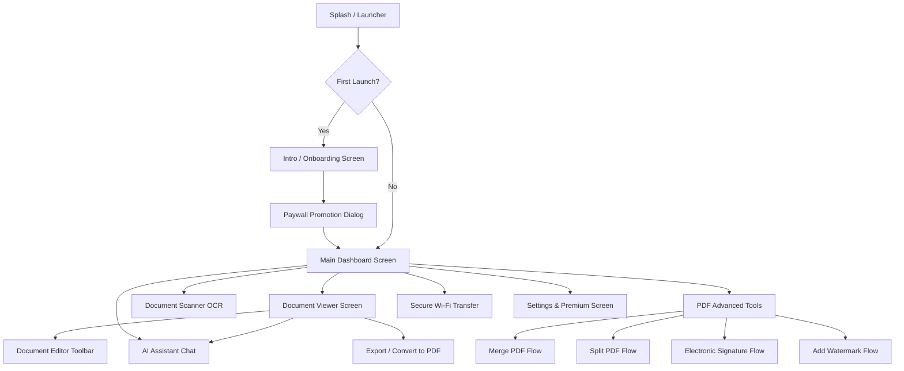

# 9. Báo Cáo Sơ Đồ Flow Màn Hình & Phân Cấp Menu, Tab Ứng Dụng

> **Mục đích:** Mô tả trực quan luồng điều hướng (User Flow), sơ đồ chuyển đổi màn hình và phân cấp cấu trúc menu cha - con từ ứng dụng gốc.

---

## 1. Sơ Đồ Luồng Người Dùng (Screen Flow Diagram)

---

## 2. Danh Sách Phân Cấp Menu & Tab (Từ Cha Xuống Con)

| Menu Cha (Parent Menu) | Menu Con (Child Menu) | Chức Năng Chi Tiết |
|---|---|---|
| **1. Trang Chủ (Home)** | - **Thanh Tìm Kiếm (Search Bar)** - **Khối Phím Tắt Nhanh (Quick Actions)** - **Bộ Lọc Loại File (DocType Chips)** - **Danh Sách Tài Liệu (Document List)** | - Tìm kiếm theo tên file & nội dung OCR - Mở nhanh AI, Scanner, PDF Tools, Transfer - Lọc DOCX, XLSX, PPTX, PDF, HWP, TXT - Mở file, đánh dấu sao, xem dung lượng & ngày sửa |
| **2. Gần Đây (Recent)** | - **Lịch Sử Đọc (Last Opened)** - **Mục Đánh Dấu Sao (Favorites)** | - Danh sách file sắp xếp theo thời gian mở gần nhất - Lọc nhanh các tài liệu quan trọng đã bookmark |
| **3. Công Cụ (Tools)** | - **Document Scanner OCR** - **Merge & Split PDF** - **Sign & Watermark PDF** - **Convert Document** - **Secure Wi-Fi Transfer** | - Chụp scan tài liệu từ camera và xuất PDF - Ghép nhiều file PDF hoặc tách trang - Vẽ chữ ký điện tử hoặc chèn watermark - Chuyển đổi HWP/Word sang PDF/DOCX - Phát Wi-Fi WebDAV chia sẻ file sang PC |
| **4. Trợ Lý AI (AI Chat)** | - **Tóm Tắt Văn Bản (Summarize)** - **Sửa Lỗi Chính Tả (Grammar)** - **Dịch Thuật Đa Ngôn Ngữ (Translate)** - **Hỏi Đáp Tự Do (Chat)** | - Rút trích 3-5 luận điểm chính của tài liệu - Rà soát chính tả, cấu trúc câu tiếng Việt/Anh - Dịch nội dung tài liệu sang ngôn ngữ đích - Trả lời các câu hỏi dựa trên ngữ cảnh file |
| **5. Cài Đặt (Settings)** | - **Gói VIP Pro (Premium Banner)** - **Ngôn Ngữ (Language Switcher)** - **Chế Độ Nền Tối (Dark Theme)** - **Xóa Bộ Nhớ Đệm (Clear Cache)** - **Chính Sách & Điều Khoản (Legal)** | - Xem trạng thái VIP, nâng cấp hoặc khôi phục đơn mua - Chọn Tiếng Việt, English, Korean, Japanese... - Bật/Tắt Dark Mode tiết kiệm pin - Dọn dẹp các tệp tạm đã convert - Xem Privacy Policy và Terms of Service |
